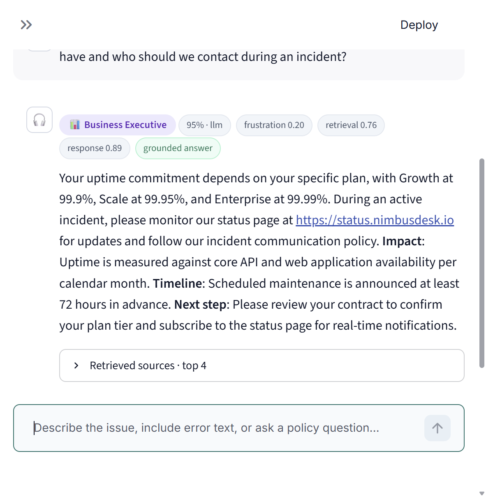
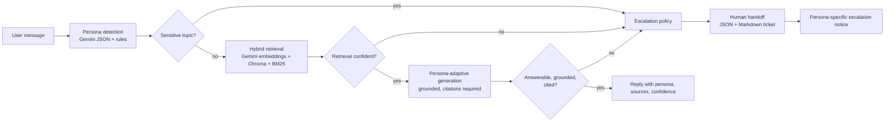

# NimbusDesk · Persona-Adaptive Customer Support Agent

A production-shaped support agent that **detects who is asking**, **retrieves evidence from a real knowledge base**, **adapts the answer** for that persona, and **escalates to a human with a complete handoff** when the case leaves safe ground.

Built for the Adsparkx AI engineering assignment. Every answer is generated live from the indexed documents — there are no canned responses, and the repository contains no pre-generated model output.

---

## What it does

| Capability | Implementation |
| --- | --- |
| Persona detection | Gemini structured JSON + deterministic rule fallback + session hysteresis; surfaced in the CLI, Streamlit, and every API reply |
| Grounded RAG | 19 realistic NimbusDesk support documents (18 Markdown/text + 1 three-page PDF), Gemini embeddings, ChromaDB cosine search, BM25 hybrid re-ranking, citations required |
| Adaptive answers | Different system instruction, structure, length, and jargon level per persona; all claims must come from retrieved chunks |
| Escalation | Deterministic sensitive-topic rules, retrieval-confidence checks, grounding/citation checks, repeated-dissatisfaction tracking, unresolved-conversation limit, explicit human requests |
| Human handoff | Structured JSON + readable Markdown ticket with persona, issue, transcript, documents used, attempted steps, recommended next steps, and escalation reasons |
| Interfaces | Streamlit chat UI (persona badges, sources, escalation panel, handoff downloads, feedback) and an interactive CLI |

## Demo

> A screen recording (3–8 minutes) and deployed URL will be added after publishing. The recording walks through the nine scripted scenarios below.



*Live run: the executive question was answered from `service_level_agreement.md` with retrieval 0.76 and response 0.89 — no escalation.*

---

## Architecture



```
User Query
   │
   ▼
Persona Detection ──────► (Technical Expert | Frustrated User | Business Executive)
   │
   ▼
Sensitive-topic detection ───────────────┐
   │                                      │
   ▼                                      │
Retrieval (top-k, fused score) ──► low confidence? ──┐
   │                                                  │
   ▼                                                  │
Grounded generation (persona prompt) ──► uncited/ungrounded? ──┤
   │                                                  │
   ▼                                                  │
Escalation check (dissatisfaction, turns, human ask) ─┤
   │                                                  │
   ▼                                                  ▼
Reply                                    Human handoff summary
```

The orchestration is explicit Python (`src/agent.py`) rather than an opaque agent framework: each stage is timed, observable, and individually testable.

### Project structure

```
.
├── app.py                      Streamlit chat UI
├── cli.py                      Interactive CLI (rich persona/source/escalation output)
├── data/                       19 support documents incl. password_reset_guide.pdf
├── src/
│   ├── agent.py                End-to-end orchestration and session state
│   ├── config.py               Environment-driven, validated settings
│   ├── documents.py            Markdown/text/PDF parsing, metadata-preserving chunking
│   ├── embeddings.py           Gemini embedder (document/query task types, auto-normalized)
│   ├── escalator.py            Sensitive rules + configurable escalation policy
│   ├── feedback.py             Append-only JSONL feedback log
│   ├── generator.py            Persona prompts, grounding rules, citation validation
│   ├── handoff.py              Structured handoff builder + JSON/Markdown persistence
│   ├── llm.py                  Gemini client, JSON schema mode, retry/backoff
│   ├── models.py               Dataclasses shared by UI, agent, and tests
│   ├── persona.py              LLM classifier, rule fallback, hysteresis, frustration score
│   └── rag.py                  Chroma index, hybrid retrieval, staleness checks
├── scripts/
│   ├── build_kb_pdf.py         Regenerates the PDF KB article (dev only)
│   ├── demo.py                 Nine-scenario end-to-end demo + transcript
│   └── ingest.py               Index build / freshness check / dry run
├── tests/                      105 pytest tests (fake LLM + fake embedder; no API calls)
├── docs/
│   └── screenshot.png          Live Streamlit run captured for this README
├── requirements.txt
├── requirements-dev.txt
├── .env.example
└── .streamlit/config.toml
```

---

## Persona strategy

### Detection

1. **Primary: Gemini structured output.** The classifier receives the latest message plus up to six prior turns and a JSON schema with `persona`, `confidence`, `reasoning`, `signals`, `frustration_score`, and `wants_human`. Temperature is 0.
2. **Fallback: weighted lexical rules.** If the model call fails, deterministic signals still classify:
   - *Technical Expert*: API, endpoint, header, bearer, OAuth/SAML/SCIM, webhook, HMAC, HTTP status codes, database engines, stack traces, configuration keys.
   - *Frustrated User*: "nothing works", "tried everything", repeated-failure phrasing, urgency, exclamation density, shouting.
   - *Business Executive*: SLA, uptime, downtime, timeline, revenue, risk, stakeholders, renewal, board-level language.
3. **Session hysteresis.** A different persona only replaces the session persona when the model is at least 55% confident. Short follow-ups ("ok, what now?") keep the established tone instead of flapping.
4. **Manual override.** The CLI (`/persona technical|frustrated|executive`) and the Streamlit sidebar can force a persona. Replies are marked `forced_persona: true` and `source: manual`, so a demo can never be mistaken for detection.
5. **Frustration score.** The model score is floored by an independent linguistic estimate (exclamations, caps ratio, frustration phrases). It feeds the repeated-dissatisfaction escalation rule.

### Response strategy

| Persona | Structure | Style rules |
| --- | --- | --- |
| Technical Expert | Diagnosis → Root cause → Resolution steps → Verification | Exact error codes, headers, endpoints, config keys; code blocks only when sourced; 250–400 words |
| Frustrated User | Short acknowledgment → numbered next actions (easiest first) → what happens next | Plain language, no policy jargon, no blame, 120–220 words |
| Business Executive | Bottom line → Impact → Timeline → Next step | Only documented timelines; no endpoint detail; 80–150 words |

All personas share the same grounding rules: answer only from supplied chunks, set `answerable_from_context: false` when the context is insufficient, never invent codes/limits/prices/timelines, never request passwords or secrets.

---

## RAG design

### Knowledge base

`data/` contains **19 documents** modeling a B2B SaaS support desk (NimbusDesk): API authentication, rate limits, billing policies, refunds/disputes, SSO/SAML, webhooks, integrations, incidents/status, SLAs, data retention/GDPR, security compliance, roles, exports, mobile sync, browser troubleshooting, email deliverability, database connectors, onboarding, and a **three-page PDF** password-reset guide (`KB-1007`). Documents are deliberately realistic: tables, limits, error codes, internal escalation rules, and policy caveats.

### Ingestion and metadata

- Markdown H2 sections, numbered text headings, and PDF pages are parsed separately.
- Chunks are created with LangChain `RecursiveCharacterTextSplitter` at **900 characters / 150 overlap**.
- Every chunk stores `source`, `title`, `section`, `chunk_index`, `doc_type`, and `page` for PDFs. Chunk IDs are `source#NNN`.
- Embedded text is prefixed with `title > section` to keep retrieval context when a chunk is short.
- A manifest records document SHA-256 hashes, embedding model/dimensions, and chunking settings. The UI and `scripts/ingest.py --check` report stale indexes after document, model, or chunking changes.

### Embeddings and vector store

- `gemini-embedding-001`, **768 dimensions**, `RETRIEVAL_DOCUMENT` for chunks and `RETRIEVAL_QUERY` for questions, L2-normalized.
- ChromaDB persistent client in cosine space; collection metadata repeats the embedding model and chunk parameters.
- Retrieval fetches 15 dense candidates, re-ranks with **BM25Okapi** damped by query-token coverage, and fuses `0.82 × dense + 0.18 × lexical`. Okapi gives zero lexical credit to absent terms, and the coverage factor stops one incidental shared token from outranking a chunk that matches most of the question. This hybrid is what keeps exact tokens such as `401`, `SAML`, `nk_live_`, and `Retry-After` retrievable.
- Only chunks at or above `MIN_RETRIEVAL_SIMILARITY` are treated as supporting evidence. The best fused score is shown as **retrieval confidence**.

### Grounding and citations

The generator returns strict JSON: `answer`, `grounded`, `answerable_from_context`, `confidence`, `citations`, `steps`, `needs_escalation`, `escalation_reason`. Citations must reference supplied context tags (`S1`, `S2`, …) or exact source filenames. If an answer is marked answerable but has no verifiable citation, the agent overrides it to "unanswerable" and escalates. An answer is never sent with silent, unsupported claims.

---

## Escalation logic

Escalation is deterministic and explainable. Each reason has a code, label, detail, and severity. The handoff preserves all of them.

| Trigger | Default | Configurable |
| --- | --- | --- |
| Account-actionable billing/refund/dispute | Refund demands, duplicate/unexpected charges, chargebacks, disputes, reversal requests | `SENSITIVE_ESCALATION_MODE=actions_only` |
| Legal / regulatory | Lawyer, lawsuit, subpoena, regulator, demand letter, formal complaint | same |
| Account-sensitive | Delete/close account or data, GDPR/CCPA erasure, ownership transfer, email change, cancellation | same |
| Payment change | Update/remove payment method or card | same |
| Security incident | Hacked/compromised account, unauthorized login, leaked key, data breach | same |
| Informational mentions | In `actions_only` mode these are answered from policy; `always` mode escalates them too | `SENSITIVE_ESCALATION_MODE=always` |
| Explicit human request | "human", "live agent", "manager", "escalate this", "speak to someone" | — |
| Low retrieval confidence | Best fused score < `0.52` **or** no supporting chunk | `MIN_RETRIEVAL_SIMILARITY`, `MIN_SUPPORTING_CHUNKS` |
| No documented answer | Generator sets `answerable_from_context: false` | — |
| Ungrounded / uncited answer | `grounded: false` or no verifiable citation | `REQUIRE_CITATIONS` |
| Agent-requested escalation | Generator flags a human action even when policy text exists | — |
| Repeated dissatisfaction | ≥ 2 consecutive negative turns **and** frustration ≥ 0.6 | `FRUSTRATION_STREAK_THRESHOLD`, `FRUSTRATION_SCORE_THRESHOLD` |
| Unresolved conversation | ≥ 6 unresolved turns with at least one negative signal | `MAX_TURNS_BEFORE_ESCALATION` |
| Retrieval outage | The vector store/search throws during a turn | — |
| Custom topics | Comma-separated phrases that always escalate | `EXTRA_SENSITIVE_TERMS` |

When a conversation has already been escalated, further messages return the existing ticket context instead of re-escalating or inventing an answer (`already_escalated`).

---

## Human handoff

Each escalation writes `handoffs/HANDOFF-<ticket>.json` and `.md`. Fields are deterministic first; an optional Gemini enrichment adds a tighter summary and next steps, validated against allowed categories and severities.

```json
{
  "ticket_id": "HD-20261109-7F3A1C",
  "session_id": "S-19AB2C4D",
  "created_at": "2026-11-09T13:42:10+00:00",
  "severity": "high",
  "persona": "Frustrated User",
  "persona_confidence": 0.94,
  "persona_reasoning": "Repeated charges, urgency, exclamation marks.",
  "issue": "Initial report: My billing statement has duplicate charges. Latest update: I demand an immediate refund!",
  "issue_category": "billing",
  "documents_used": ["refund_and_dispute_policy.md", "billing_policies.txt"],
  "retrieved_sources": [
    {"source": "refund_and_dispute_policy.md", "title": "Refund and Dispute Policy", "section": "Refund eligibility", "page": null, "score": 0.74, "chunk_id": "refund_and_dispute_policy.md#002"}
  ],
  "attempted_steps": ["Cleared browser cookies and site data"],
  "conversation_history": [
    {"role": "user", "content": "My billing statement has unexpected duplicate charges.", "persona": "Frustrated User", "timestamp": "2026-11-09T13:41:58+00:00"},
    {"role": "assistant", "content": "I'm really sorry — ... ticket HD-20261109-7F3A1C", "persona": "Frustrated User", "timestamp": "2026-11-09T13:42:10+00:00"}
  ],
  "recommendation": "Billing dispute or refund request. Review the transcript and retrieved sources, then continue the case as a human owner (billing).",
  "recommended_next_steps": [
    "Verify the workspace's invoices, payment method, and processor settlement records.",
    "Review refund or credit eligibility against the refund and dispute policy; do not promise an outcome.",
    "Reply to the customer with the investigation timeline and next update."
  ],
  "escalation_reasons": [
    {"code": "sensitive_billing_dispute", "label": "Billing dispute or refund request", "detail": "Matched 'duplicate charges'; requires Finance Operations and cannot be resolved in chat.", "severity": "high"}
  ],
  "customer_context": {"frustration_score": 0.88, "turn_count": 1, "wants_human": false},
  "latest_message": "I demand an immediate refund!"
}
```

The customer-facing escalation notice is also persona-specific and includes the ticket reference. The Streamlit UI exposes both files as downloads.

---

## Tech stack

| Component | Version |
| --- | --- |
| Python | 3.11+ (tested on 3.12) |
| `google-genai` | 3.0.0 |
| Chat model | `gemini-2.5-flash` (default, configurable) |
| Embeddings | `gemini-embedding-001`, 768 dims |
| `chromadb` | 1.5.9 |
| `streamlit` | 1.67.0 |
| `langchain-text-splitters` | 1.1.3 |
| `pypdf` | 7.0.0 |
| `rank-bm25` | 0.2.2 |
| `python-dotenv` | 1.2.4 |
| `pytest` (dev) | 9.2.0 |
| `reportlab` (dev, PDF regeneration) | 5.1.0 |

---

## Setup

### 1. Clone and install

```bash
git clone <your-repo-url>
cd <repo>
python -m venv .venv

# Windows
.venv\Scripts\activate
# macOS / Linux
source .venv/bin/activate

pip install -r requirements.txt
```

### 2. Configure the API key

Create a key at <https://aistudio.google.com/apikey>.

```bash
cp .env.example .env
# edit .env and set GEMINI_API_KEY=...
```

`.env` is gitignored. Never commit it. For Streamlit Community Cloud, use the app's **Secrets** panel instead:

```toml
GEMINI_API_KEY = "..."
```

### 3. Build the index

```bash
python scripts/ingest.py --dry-run   # parse + chunk, no API calls
python scripts/ingest.py             # embed 181 chunks and create chroma_db/
python scripts/ingest.py --check     # freshness check, no API calls
```

The Streamlit app can also build the index on first launch if it is missing.

### 4. Run

```bash
streamlit run app.py     # chat UI
python cli.py            # interactive CLI
python cli.py --query "Bearer token returns 401" --json
```

### 5. Run the demo and tests

```bash
python scripts/demo.py
pytest -q
```

The demo calls the real Gemini agent across nine scenarios and writes `demo_output/demo_transcript.md`. Tests use a scripted LLM and deterministic fake embedder, so they require **no API key and no network**.

---

## Environment variables

| Variable | Default | Purpose |
| --- | --- | --- |
| `GEMINI_API_KEY` | — | Required for ingestion, generation, and the UI |
| `CHAT_MODEL` | `gemini-2.5-flash` | Persona, generation, and handoff model |
| `EMBEDDING_MODEL` | `gemini-embedding-001` | Embedding model |
| `EMBEDDING_DIMENSIONS` | `768` | Output dimensionality |
| `EMBEDDING_BATCH_SIZE` | `32` | Ingestion batch size |
| `EMBEDDING_INPUTS_PER_MINUTE` | `90` | Paces embedding calls under the free-tier 100-inputs/min limit; `0` disables pacing |
| `MAX_RETRIES` | `4` | Retries for 429/5xx/timeouts |
| `RETRY_BASE_DELAY_S` | `1.5` | Exponential backoff base |
| `CHUNK_SIZE` | `900` | Characters per chunk |
| `CHUNK_OVERLAP` | `150` | Overlap between chunks |
| `TOP_K` | `4` | Chunks supplied to the generator |
| `CANDIDATE_K` | `15` | Dense candidates before re-ranking |
| `MIN_RETRIEVAL_SIMILARITY` | `0.52` | Lowest fused score considered supporting evidence |
| `MIN_SUPPORTING_CHUNKS` | `1` | Minimum supporting chunks |
| `ENABLE_LEXICAL_RERANK` | `true` | BM25 hybrid re-ranking |
| `LEXICAL_WEIGHT` | `0.18` | Lexical share of the fused score |
| `REQUIRE_CITATIONS` | `true` | Escalate answers without verifiable citations |
| `SENSITIVE_ESCALATION_MODE` | `actions_only` | `actions_only` answers policy questions; `always` escalates any sensitive mention |
| `FRUSTRATION_STREAK_THRESHOLD` | `2` | Consecutive negative turns before escalation |
| `FRUSTRATION_SCORE_THRESHOLD` | `0.6` | Frustration required with the streak |
| `MAX_TURNS_BEFORE_ESCALATION` | `6` | Unresolved-turn limit |
| `EXTRA_SENSITIVE_TERMS` | empty | Comma-separated always-escalate phrases |
| `DATA_DIR` | `data` | Knowledge-base directory |
| `CHROMA_DIR` | `chroma_db` | Persistent vector store |
| `COLLECTION_NAME` | `nimbusdesk_kb` | Chroma collection |
| `HANDOFF_DIR` | `handoffs` | Handoff JSON/Markdown output |
| `FEEDBACK_FILE` | `feedback/feedback.jsonl` | UI feedback log |

Relative paths resolve against the project root.

---

## Example queries

| Query | Expected persona | Expected outcome |
| --- | --- | --- |
| "Where is the guide to clear cookies? It's been an hour and nothing is loading on your interface!" | Frustrated User | Empathetic numbered steps; cites `browser_troubleshooting.txt`; no escalation |
| "What are the header parameter requirements for your bearer token auth implementation? Include the exact error codes for an invalid key." | Technical Expert | Diagnosis/root cause/steps; `Authorization: Bearer`, `401`, `auth_token_expired`; cites `api_authentication.md` |
| "Our operational uptime is decreasing. What uptime commitment do we have and who should we contact during an incident?" | Business Executive | Bottom line + impact/timeline/next step; cites `service_level_agreement.md`; no escalation (informational) |
| "I'm experiencing internal errors on ticket pages from our PostgreSQL database integration." | Technical Expert | Connector diagnostics and root-cause steps; cites `database_connectors.md` |
| "My billing statement has unexpected duplicate charges. I demand an immediate refund!" | Frustrated User | **Escalates** `sensitive_billing_dispute`; billing handoff with ticket ID and refund-safe next steps |
| "Can you ship a physical welcome kit to our Antarctic research station, and what import tax applies?" | Any | **Escalates** `low_retrieval_confidence` with no answer; the handoff lists the weakly retrieved sources at their low scores instead of asserting logistics facts |
| "Our whole team is locked out of SSO and nobody can log in!" → "I already cleared cookies and tried incognito, and it still doesn't work. This is unacceptable." | Frustrated User | First turn answers; second turn **escalates** `repeated_dissatisfaction` |
| "I need to speak to a human agent about our renewal." | Any | **Escalates** `human_requested`; handoff includes the request |

Demo cases also cover the PDF reset guide (page-level citation), executive export-risk questions, and multi-turn frustration.

### CLI commands

```
/help                         Show commands
/persona auto|technical|frustrated|executive
/sources                      Last reply's retrieved chunks
/handoff                      Last handoff summary
/stats                        Index and session statistics
/rebuild                      Rebuild the vector index
/reset                        Start a new session
/quit
```

---

## Deployment

The app is a standard Streamlit app.

1. Push this repository to GitHub (public).
2. On <https://share.streamlit.io>, create an app pointing at `app.py`.
3. Add `GEMINI_API_KEY` under **Settings → Secrets**.
4. On first load, click **Build knowledge base now** (the index is intentionally gitignored and rebuilt from `data/`). Alternatively, run `python scripts/ingest.py` in an environment with persistent storage.

Notes for hosted deployments:

- Streamlit Community Cloud storage is ephemeral. A cold start rebuilds the index; the app handles this gracefully.
- `handoffs/` and `feedback/` are written to the instance's local disk. For durable retention, point `HANDOFF_DIR`/`FEEDBACK_FILE` at mounted storage or persist them to a database (out of scope for this assignment).

---

## Testing

```bash
pytest -q          # 105 tests
ruff check .       # lint (E/F/I rule set pinned in ruff.toml)
```

Coverage includes:

- real-corpus parsing and metadata (19 docs, 181 chunks, PDF pages, footer stripping);
- chunking, IDs, and overlap validation;
- index build, cosine space, retrieval ranking, top-k, thresholding, and staleness detection;
- retry backoff that honors Gemini's `RetryInfo` delay, and embedding pacing under the free-tier minute budget;
- rule and LLM persona classification, forced personas, hysteresis, frustration scoring;
- sensitive-topic detection for every category, actions-only vs always modes, custom terms;
- every escalation trigger and refusal to escalate an answerable informational question;
- citation validation, uncited-answer rejection, malformed model output, model/retrieval failures;
- handoff fields, enrichment, invalid-enrichment fallback, JSON/Markdown persistence, long-transcript truncation;
- end-to-end agent flows: answered turns, refund escalation, follow-up after escalation, low confidence, repeated dissatisfaction, human request, retrieval outage, resolution reset, forced persona.

## Known limitations

- **English knowledge base.** The prompt asks the model to reply in the customer's language, but retrieval quality and testing target English.
- **Single-message persona signals.** Hysteresis smooths short follow-ups, but a one-word message carries little evidence. Manual override exists for demos.
- **Threshold calibration.** `0.52` is tuned for `gemini-embedding-001` + the included corpus. Changing the embedding model or chunking requires a rebuild and re-calibration (`MIN_RETRIEVAL_SIMILARITY`).
- **Chunk-level evidence.** Long, multi-document synthesis is bounded by `TOP_K`; there is no iterative retrieval loop.
- **Self-reported confidence.** Response confidence blends retrieval score and model confidence; it is not a calibrated probability.
- **Local persistence.** Handoffs and feedback are files, not a ticketing/CRM integration. Chroma runs locally in-process.
- **No authentication.** The demo assumes a trusted operator; it is not hardened for public multi-tenant use, PII retention policies, or abuse controls.
- **Model variability.** Gemini output is non-deterministic even at low temperature; the deterministic checks are what keep unsafe or uncited answers from reaching the user.
- **Quotas.** Gemini rate limits can slow ingestion or trigger retry backoff; the ingestion script reports progress and retries 429/5xx responses.

## Security and privacy

- No API keys or secrets are committed; `.env`, `.streamlit/secrets.toml`, indexes, handoffs, and feedback are gitignored.
- The prompt forbids requesting passwords, MFA codes, full card numbers, or API secrets.
- Sensitive account actions are never executed in chat; they are escalated with identity-verification next steps.
- The customer-facing text never exposes internal scores or system instructions.
- Feedback logs store only message excerpts and cited source names for demo purposes.

---

## Submission checklist

- [x] Public-ready repository structure
- [x] 19 realistic support documents, including a multi-page PDF
- [x] Chunking with source/section/page metadata
- [x] Gemini embeddings + ChromaDB vector store + top-k hybrid retrieval
- [x] Persona detection for all three personas, displayed in CLI and UI
- [x] Persona-adaptive answers grounded in retrieved context with required citations
- [x] Configurable escalation logic covering every required trigger
- [x] Structured human handoff summary (JSON + Markdown)
- [x] Interactive CLI and Streamlit chat UI
- [x] Tests with fake providers (no network/API key)
- [ ] Screen recording (3–8 minutes) — link here
- [ ] Public GitHub repository URL — link here
- [ ] Published/deployed link — link here
